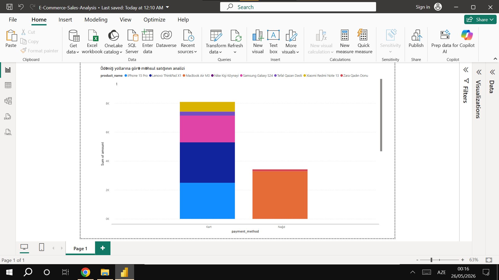

# E-Commerce Sales Analysis Dashboard

An end-to-end analysis of e-commerce sales data. The data is structured and cleaned with SQL (PostgreSQL) and visualized in an interactive Power BI dashboard.

## Business questions
- How do sales split by payment type (card vs. cash)?
- Which products sell the most?
- What is the total sales amount?

## Tools
- PostgreSQL for building and cleaning the data
- Power BI Desktop for the dashboard
- Git and GitHub for version control

## Dashboard

The dashboard shows product sales by payment method, the total sales amount, and the top-selling products (for example MacBook Air M3, iPhone 15 Pro, and Lenovo ThinkPad).
